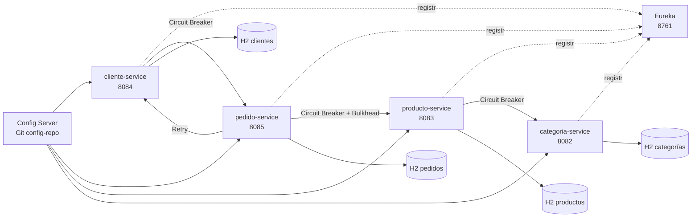

# Arquitectura del laboratorio

## Componentes y llamadas

## Fronteras de resiliencia

- `cliente-service → pedido-service`: Circuit Breaker `pedidoService`; fallback de pedidos vacío cuando pedido-service no está disponible.
- `pedido-service → cliente-service`: Retry `clienteRetry`; tres intentos como máximo, con dos segundos entre intentos y un fallback de cliente.
- `pedido-service → producto-service`: Bulkhead `productoBulkhead` limita a dos llamadas simultáneas y espera hasta un segundo; Circuit Breaker `productoService` detiene consultas lentas o fallidas y entrega un producto temporal.
- `producto-service → categoria-service`: Circuit Breaker `categoriaService`; los productos permanecen disponibles con una categoría temporal.

Config Server publica propiedades por nombre de aplicación y perfil. Cada servicio usa H2 y puerto `808x` en desarrollo; el perfil `prod` separa su puerto `909x` y su URL MySQL.
